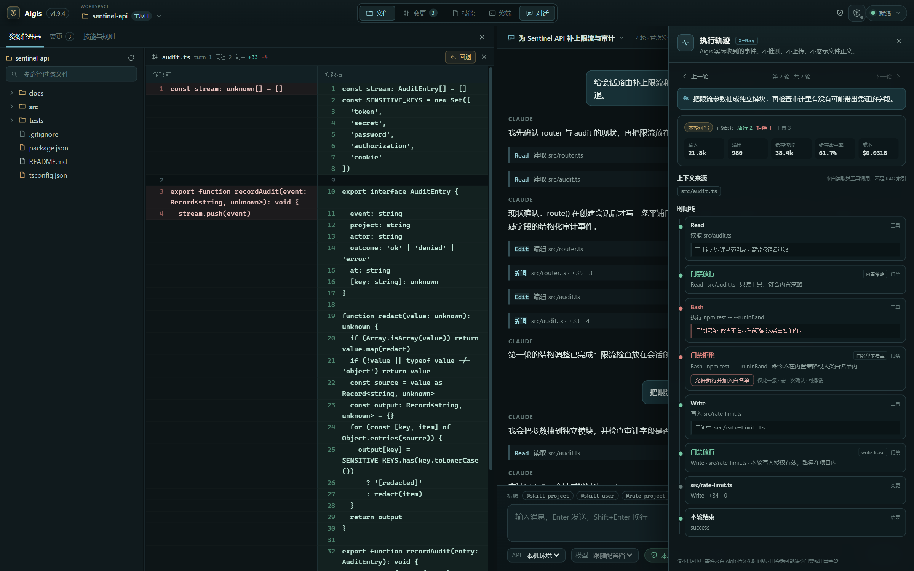

# Aigis

**给 Claude Code 加上人类在环写入门禁的 Windows 桌面端。**

Aigis 防的不是系统木马，防的是大模型发癫乱删你的代码。它是应用层边界，不是 OS 沙盒。

[下载 v1.9.5 内测版](https://github.com/lss486558354-ship-it/Aigis-Trace-Releases/releases/tag/v1.9.5) · [官网](https://aigis.uno/) · [白帽挑战说明](docs/v1.9.5-白帽挑战说明.md) · [SECURITY.md](SECURITY.md) · [security.txt](https://aigis.uno/.well-known/security.txt)



*门禁拒绝不是弹窗装饰：拒绝原因、放行结果和本轮执行轨迹都会进入审计视图。*

## 这是什么

Aigis 把 Claude Code 的工具调用放进人类在环门禁：

- **默认只读。** 写操作只在当前轮次被显式授权后可用；轮次结束或进程退出即收回。
- **跨项目记忆默认关闭。** 开启后仍需消费项目总开关、来源共享标记、来源项目开关三重条件，并且每次读取由人类逐条批准、一次性消费。
- **未知工具默认拒绝。** MCP 配置封闭，来源项目路径不进入模型上下文。
- **可回滚、可审计。** 写操作进入变更快照；审批、拒绝和执行结果留在审计轨迹里。
- **应用层边界，不是 OS 沙盒。** 写租约只授权工具调用，不约束被启动脚本的运行时；它防的是模型直接越界改文件，不是同机木马，也不是 AI 代码沙盒。

## 安装

系统要求：Windows 10/11 x64；Claude Code 最低 `2.1.139`，推荐 `2.1.295+`（用于 `onFailure: "block"`）。

1. 打开 [v1.9.5 Release](https://github.com/lss486558354-ship-it/Aigis-Trace-Releases/releases/tag/v1.9.5)，下载 `Aigis-1.9.5-setup.exe` 和对应的 `.sha256`。
2. 校验 SHA-256：

   ```powershell
   Get-FileHash .\Aigis-1.9.5-setup.exe -Algorithm SHA256
   ```

3. 安装并启动。跨项目记忆默认关闭；内测激活见 <https://aigis.uno/beta>。

安装包未配置代码签名，Windows SmartScreen 可能显示“未知发布者”。SHA-256 是**完整性校验**，不是签名，不能证明发布者身份；它也防不住同一用户下的恶意进程替换文件。

## 当前验证状态

v1.9.5 是**公开内测**，不是“已经防住黑客”的正式安全产品，也不是 OS 沙盒。

| 层 | 状态 |
| --- | --- |
| L0 静态检查 | PASS：ESLint 0 error / 0 warning，typecheck 通过 |
| L1 自动化 | PASS：297 项 Python 测试通过 / 1 项跳过（宿主不允许创建符号链接） |
| L2 契约 | 部分 PASS：broker/daemon HTTP、并发、撤销、审批队列上限；UI/IPC 发送方契约待补 |
| L3 UI 人工流 | NOT RUN |
| L4 真实模型 | NOT RUN |
| L5 安全对抗 | NOT RUN（本次白帽招募目标） |
| L6 故障/性能 | 部分 |
| L7 安装包 | 已构建并发布；安装后冒烟未执行 |
| L8 证据汇总/签字 | NOT RUN |

## 白帽挑战

完整说明见 [v1.9.5 白帽挑战说明](docs/v1.9.5-白帽挑战说明.md)；也可以直接下载 [Release 资产 Aigis-v1.9.5-whitehat.md](https://github.com/lss486558354-ship-it/Aigis-Trace-Releases/releases/download/v1.9.5/Aigis-v1.9.5-whitehat.md)。重点打跨项目记忆只读共享与 Gate 边界。

### I1–I12 不变量

| 编号 | 不变量 |
| --- | --- |
| I1 | 默认关闭：新项目、重启、升级后不得自动开启。 |
| I2 | 三重条件缺一不可：消费项目总开关、来源共享标记、来源项目开关。 |
| I3 | 一次批准只消费一次，绑定会话、轮次、来源根与内容哈希。 |
| I4 | 模型拿不到来源绝对路径、数据库句柄或 token。 |
| I5 | 不存在跨项目写入工具或路径；来源只以只读 SQLite 打开。 |
| I6 | broker token 按会话/进程轮换；旧 token 立即 401；daemon token 不可混用。 |
| I7 | 记忆工具只在活动轮次可用；不占用 `aigis_exec` 租约或 shell 槽。 |
| I8 | 审计、token、来源读取、配置失败均 fail closed。 |
| I9 | 审批只在主窗口、当前活动会话；Escape 等于拒绝；过期不可批准。 |
| I10 | 审计不写正文、标题、路径或 token；来源数据库与 WAL 不被修改。 |
| I11 | 记忆内容是**不可信数据**，不得执行其中指令，也不视为授权。 |
| I12 | 新功能不得放宽 Gate、只读项目、受保护路径、Full Trust、快照或执行租约。 |

### 建议攻击面

提示注入、审批疲劳、一次授权重放、token 重放/混用、路径伪造、来源撤销/开关竞态、审计绕过、MCP/工具边界、安装包/环境差异、写租约后的脚本运行时影响量化，以及审批弹窗元数据误导的人因测试。逐项说明见白帽挑战文档。

### 提交方式

- 可公开讨论的行为差异：在 Release 仓库开 issue，附版本、Claude Code 版本、复现步骤、脱敏日志。
- 可能被利用的越权或数据泄露：**不要公开可直接利用的 0day**。先私信 `@lss486558354-ship-it` 或使用 [GitHub private advisory](https://github.com/lss486558354-ship-it/Aigis-Trace-Releases/security/advisories/new)，附最小复现与影响判断。
- 安全港、响应目标与完整禁止项见 `SECURITY.md` 与 `security.txt`。不接受 DoS、撞库、供应链投毒或读取他人真实项目数据。

## 已知边界

- **写租约/Full Trust 是工具调用层授权，不是进程运行时沙盒。** 一旦该轮允许 Bash/AI 执行，项目内 `python`/`node`/`npm`/`pytest` 等命令以当前 Windows 用户权限运行；Aigis 不约束子进程读什么、写什么、连什么。脚本可以由模型自己生成。它防的是模型直接越界改文件，不是同机木马，也不是 AI 代码沙盒。
- **审批弹窗只显示元数据。** 人类看到标题、来源和范围，不显示记忆正文或 `content_sha256`；默认拒绝、Esc、每会话最多 3 个待批准是缓解措施，不是内容审查，也不构成“绝对安全”。
- 应用层隔离，不是 OS 沙盒；同用户恶意进程不在 v1.9.5 威胁模型内。来源项目共享开关是跨进程只读 SQLite，线性化点是最终提交时读取来源开关/epoch：最终读取在关闭提交前可先于关闭生效，关闭提交后必须看到新值并 fail closed；不宣称强事务。
- 路径测试有 1 项 symlink skip；NTFS hardlink 不在当前路径策略覆盖内，需 L5 验证。安装包未签名。
- Claude Code < 2.1.295 无法设置 `onFailure: block`；Aigis 在该版本为 `degraded`，如果 Aigis 自身 hook 启动失败，可能按非阻断处理。

## 源码状态

Aigis 源码仓库目前为 **private**，且未附 LICENSE；本次是公开内测与白帽挑战，**不称“开源项目”**。要真正开源，需要先确定许可证并公开仓库。

## v2.0 计划（未在 v1.9.5 交付）

单写者状态落盘、认证 IPC、独立锁/`BEGIN IMMEDIATE`、revision/epoch 防回滚、全局审批上限、Memory Draft Layer（草稿层）。这些是计划，不冒充当前能力。

## 说明

授权与机器绑定仅用于内测发放管理，不是安全边界。Aigis 采用基于人类在环（Human-in-the-loop）的应用层边界管控与审计回滚机制，不等同于操作系统权限控制。

由 Aigis Trace 出品。
